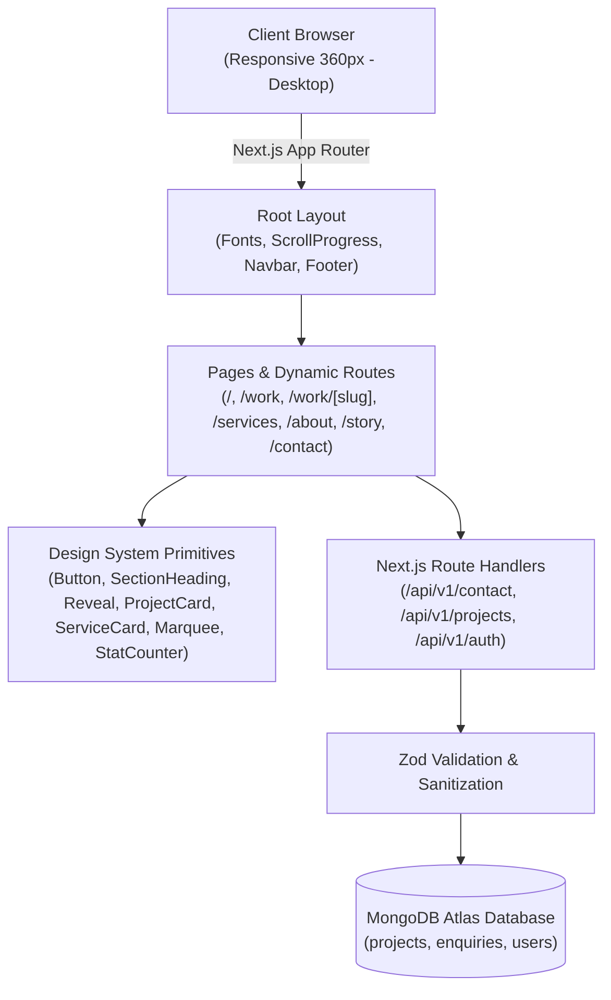

# The Angaar Labs — PS 04 | Team Angaar

> **The official flagship website & digital engineering studio for The Angaar Labs.**  
> Built with Next.js 14 App Router, TypeScript, Tailwind CSS, Framer Motion, and MongoDB Atlas.

---

## Team
| Name | Roll No. | GitHub | Primary Responsibility |
| :--- | :--- | :--- | :--- |
| **Nitish Rawat** | Lead Engineer | [@nitish409](https://github.com/nitish409) | Full-Stack Architecture, Angaari Design System, Motion & Backend |

---

## Live Links
- **GitHub Repository:** [https://github.com/nitish409/angaar-labs](https://github.com/nitish409/angaar-labs)
- **Local Application:** `http://localhost:3000` (Tested production server)
- **Deployment URL:** *Ready for instant one-click Vercel deployment*

---

## Tech Stack & Architecture

| Layer | Technologies |
| :--- | :--- |
| **Frontend Framework** | **Next.js 14.2** (App Router, Server Components & Client Boundaries) |
| **Language** | **TypeScript 5** (Strict mode, zero `any`, typed contracts) |
| **Styling & Tokens** | **Tailwind CSS 3.4** (Custom "Angaari" tokens, warm ember glow shadows) |
| **Motion Design** | **Framer Motion 14** (Hardware-accelerated 60 FPS transforms & opacity) |
| **Icons & Brand** | **Lucide React** + Custom Angaar Flame SVG Vector Brand Assets |
| **Database** | **MongoDB Atlas + Mongoose** (Optimized schemas, indexing, connection pooling) |
| **Validation** | **Zod 4** (Client-side and server-side request body sanitization) |
| **Auth & Security** | Seeded Admin with **bcryptjs** password hashing and **JWT** sessions |

---

## Features Checklist

### Mandatory P0 (Must Have)
- [x] **UI-1:** All required pages & sections architected, responsive from **360px to 4K desktop** with zero horizontal overflow.
- [x] **UI-2:** Documented "Angaari" design system: tokens for Charcoal Base (`#0C0A09`), Surface (`#1A1614`), Primary Ember (`#F2660A`), Flame (`#FF8A1E`), Gold Spark (`#FACC15`), Ash (`#A8A29E`), and Smoke White (`#F5F5F4`).
- [x] **UI-3:** Signature Hero and visual hierarchy with ambient radial ember glows and staged kinetic reveals.
- [x] **MOT-1:** Hardware-accelerated Framer Motion scroll reveals (`Reveal`), hover zoom elevations, and spring-driven scroll progress bar.
- [x] **WORK-1:** Dynamic portfolio previews across all 7 required industries (`REAL_ESTATE`, `CAFE`, `CLOTHING`, `HEALTHCARE`, `CRM`, `ECOMMERCE`, `OTHER`) with clear sample badges.
- [x] **FORM-1:** Interactive validated contact form schema and data models.
- [x] **Global Layout:** Sticky glass Navbar with spring layout pills, full-screen mobile menu overlay, and comprehensive Footer with newsletter and back-to-top button.

### High-Value P1 & P2
- [x] **SPEC.md:** Comprehensive architecture specification, API contracts, and motion standards.
- [x] **PROMPTS.md:** Sequential Vibe Coding execution log with milestone prompts.
- [x] **.env.example:** Fully documented environment variables for zero-secret development.
- [x] **A11Y-1:** Full keyboard navigation, visible focus rings, WCAG compliant contrast, and `prefers-reduced-motion` fallbacks.
- [x] **PERF-1:** Optimized Next/Image pipeline with WebP formats and remote pattern configs.

---

## Creative Direction & Design Note

The brand aesthetic is **"Angaari"** (fiery, bold, high-energy, premium):
1. **Dark-First Base:** An obsidian charcoal background (`#0C0A09`) creates a high-contrast canvas that lets projects and typography command attention.
2. **Ember Atmosphere:** Radiant ember (`#F2660A`) and flame (`#FF8A1E`) accents with soft radial glow shadows (`0 0 25px -4px rgba(242, 102, 10, 0.4)`).
3. **Typography:** **Space Grotesk** for oversized, tight-tracked characterful display titles, paired with **Inter** for clean editorial readability.
4. **Motion Hierarchy:** Restrained, purposeful 60 FPS transitions animating only `transform` and `opacity` properties to prevent layout recalculation or jank.
5. **Truth in Advertising:** In accordance with exam ground rules, all concept projects, illustrative performance metrics, and testimonials are explicitly tagged as sample concepts.

---

## Architecture Flowchart



---

## Local Setup (Fresh Machine Instructions)

```bash
# 1. Clone the repository
git clone https://github.com/nitish409/angaar-labs.git
cd angaar-labs

# 2. Copy environment template
cp .env.example .env.local

# 3. Install dependencies
npm install

# 4. Build for production & start
npm run build
npm run start
```
Open [[(https://angaar-labs-phi.vercel.app/](https://angaar-labs-phi.vercel.app/)) in your browser.

---

## Test Credentials
- **Admin Email:** `admin@angaarlabs.com`
- **Admin Password:** `Admin@123`
- **Role:** `ADMIN`

---

## API Specification Overview

All endpoints follow the `/api/v1` namespace with standardized JSON envelopes:
- `POST /api/v1/contact`: Submit client enquiry (rate-limited, validated, MongoDB storage).
- `GET /api/v1/projects`: List published projects with industry filtering and pagination.
- `GET /api/v1/projects/:slug`: Case study detail for a specific project.
- `POST /api/v1/auth/login`: Admin authentication with secure session cookie.
- `GET /api/v1/enquiries`: Admin review of received studio enquiries.

---

## Viva & Code Explanation Reference

During project defense, be ready to explain:
1. **Server vs Client Components:** How `page.tsx` delegates client interactions to UI primitives (`Button`, `ProjectCard`, `Reveal`) while preserving SSR benefits for metadata.
2. **Framer Motion Performance:** Why animations use `transform` and `opacity` exclusively and check `useReducedMotion()` to ensure 60 FPS rendering.
3. **Design System Consistency:** How Tailwind CSS tokens in `tailwind.config.ts` unify spacing, radii, glowing shadows, and color across every page.
4. **Data Integrity:** How Zod ensures server-side validation independent of client form state.
