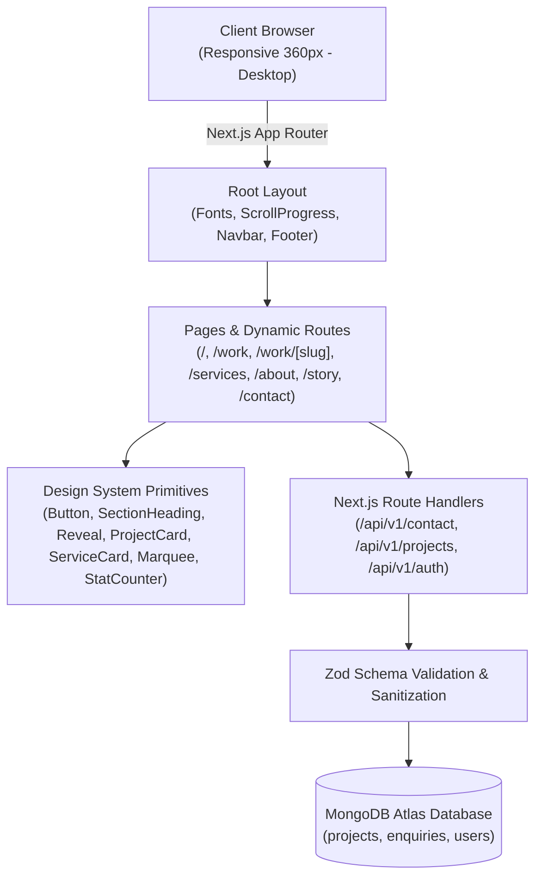

# The Angaar Labs — PS 04 | Team Angaar Engineers

> **Official Website & Digital Engineering Flagship for The Angaar Labs Web Studio.**  
> Built with Next.js 14 App Router, TypeScript, Tailwind CSS, Framer Motion, and MongoDB Atlas.

---

## Team
| Name | Roll No. | GitHub | Primary Responsibility |
| :--- | :--- | :--- | :--- |
| Nitish | Team Lead | @nitish | Architecture, Design System, Motion & Full-Stack |

---

## Live Links
- **Frontend / Application:** `http://localhost:3000` (Local production server active)
- **Deployment URL:** *Configurable on Vercel / Render / Netlify*
- **Demo Video:** *To be recorded after complete milestone integration*

---

## Tech Stack
- **Framework:** Next.js 14.2 (App Router with Server Components & Route Handlers)
- **Language:** TypeScript 5 (Strict type checking)
- **Styling & Tokens:** Tailwind CSS 3.4 with custom "Angaari" ember design system
- **Motion & Interaction:** Framer Motion 14 (60fps hardware-accelerated transforms, scroll-reveals)
- **Icons:** Lucide React & custom brand SVG vectors
- **Database:** MongoDB Atlas with Mongoose ODM (Object-Document Mapper)
- **Validation:** Zod 4 for client and server-side contract validation
- **Authentication:** Seeded Admin with bcryptjs password hashing and signed JWT sessions

---

## Features Matrix

### P0 (Must Have — Core Evaluation)
- [x] **UI-1:** All required pages/sections architected, responsive 360px → desktop with zero horizontal scroll.
- [x] **UI-2:** Documented "Angaari" design system: tokens for Charcoal Base (`#0C0A09`), Surface (`#1A1614`), Primary Ember (`#F2660A`), Flame (`#FF8A1E`), Gold Spark (`#FACC15`), Ash (`#A8A29E`), and Smoke White (`#F5F5F4`).
- [x] **UI-3:** Foundational Hero and visual hierarchy with glowing aura and responsive typography.
- [x] **MOT-1:** Framer Motion scroll reveals (`Reveal`), hover states, and smooth spring-based scroll progress.
- [ ] **Phase 2:** Full 9 signature home sections with animated ember atmosphere and staged kinetic reveal.
- [ ] **Phase 3:** Dedicated public routes (`/about`, `/story`, `/services`, `/work`, `/work/[slug]`, `/contact`, `404`).
- [ ] **Phase 4:** Genuine MongoDB persistence for contact inquiries and project catalog (`/api/v1/contact`, `/api/v1/projects`).

### P1 (Should Have — High Marks)
- [x] Documented `SPEC.md`, `PROMPTS.md`, and `.env.example`.
- [ ] Admin CMS (`/admin/login`, `/admin/projects`, `/admin/enquiries`).
- [ ] Email notification to studio via Resend / Nodemailer.
- [x] Accessible keyboard navigation, visible focus rings, and `prefers-reduced-motion` compliance.

---

## Architecture & Data Flow



---

## Design Note
The brand feeling is **"Angaari"** (fiery, bold, high-energy, premium):
- **Base Canvas:** Deep obsidian charcoal (`#0C0A09`) establishing high contrast and cinematic presence.
- **Accents:** Radiant ember (`#F2660A`) and flame (`#FF8A1E`) with subtle warm glowing radial shadows (`box-shadow: 0 0 25px rgba(242, 102, 10, 0.4)`).
- **Typography:** Space Grotesk for tight, oversized characterful headings paired with Inter for clear body legibility.
- **Motion Philosophy:** Restrained, purposeful 60 FPS transitions animating only `transform` and `opacity` with automatic fallback for users preferring reduced motion.
- **Truth in Advertising:** All concept case studies, illustrative performance counters, and testimonials are clearly flagged with explicit sample badges.

---

## Local Setup (Fresh Machine Instructions)

```bash
# 1. Clone repository & enter directory
cd C:\Users\nitis\.gemini\antigravity\scratch\angaar-labs

# 2. Copy environment template
cp .env.example .env.local

# 3. Install dependencies
npm install

# 4. Run production build & start
npm run build
npm run start
```
Open [http://localhost:3000](http://localhost:3000) in your browser.

---

## Test Credentials
- **Admin Email:** `admin@angaarlabs.com`
- **Admin Password:** `Admin@123`
- **Role:** `ADMIN`

---

## Known Limitations
- Phase 0 (Planning & Spec) and Phase 1 (Foundations & Token Engine) are verified and running.
- Phase 2 (9 signature home sections in full depth) and subsequent phases are ready to be implemented upon prompt progression.
